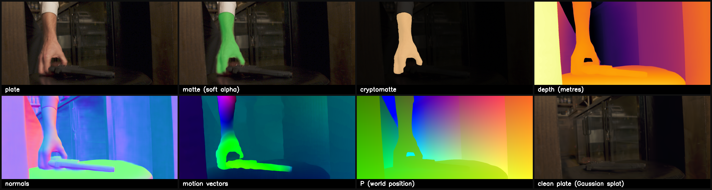
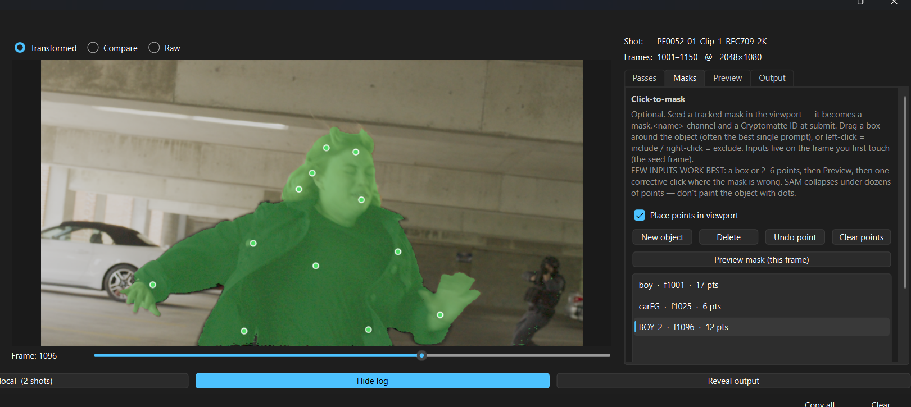
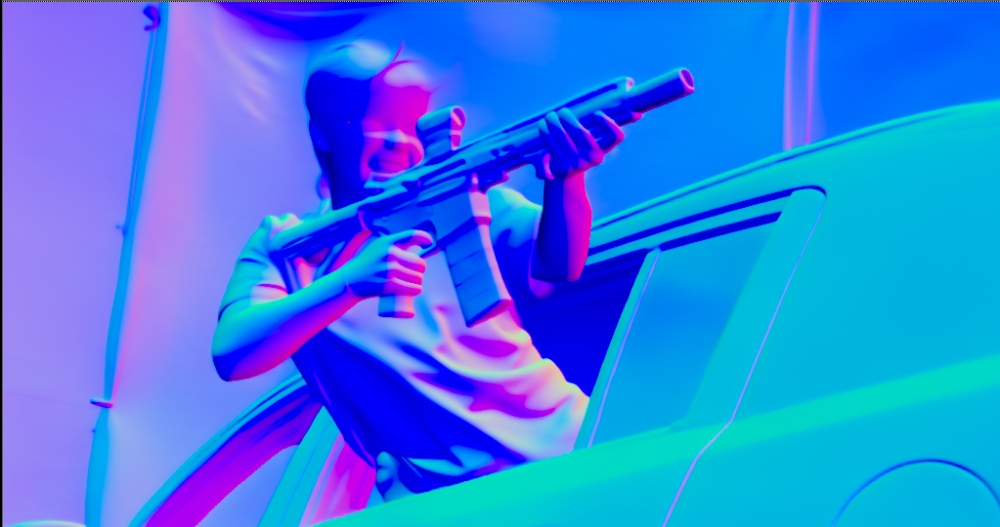
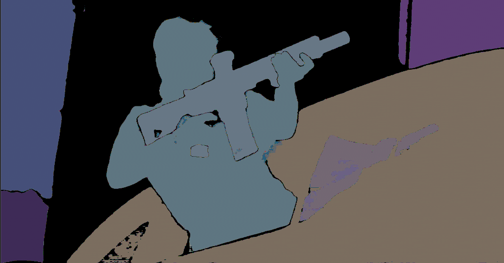
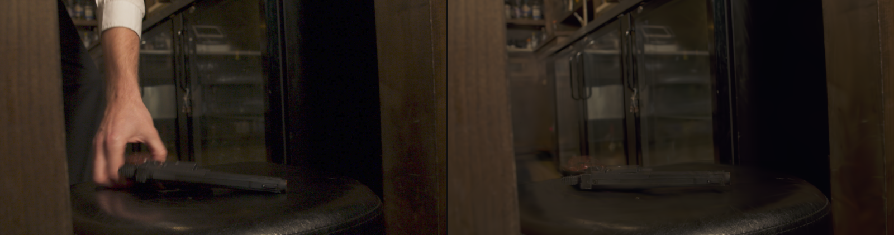

<p align="center">
  
</p>

# LiveActionAOV

**Live-action plates in, Nuke-ready AOVs out.** Point it at an EXR sequence and you get per-object mattes and a Cryptomatte, depth in metres, normals, motion vectors, a solved camera, a clean plate, and a Nuke script with all of it wired up. It runs on your own machine; the only thing that ever goes over the network is the optional LTX Alpha step, and only if you point it at a ComfyUI on another box.

Built by [Leonardo Paolini](#author), a VFX and 2D compositing supervisor, for the prep work that eats the first days of every shot. In development since April 2026 and in daily use on real shots; some parts are still moving, see [Status](#status).

<p align="center">
  
</p>

## What you get

From one plate folder, one run writes a version folder next to it:

| Output | What it is | How |
|---|---|---|
| **Mattes** | Soft, roto-grade alpha per object you clicked, with hair and motion blur | SAM 3 tracks the object, ViTMatte refines the edge; **LTX-2.5 Alpha** optional for the hard ones |
| **Cryptomatte** | Every object as a pickable ID, like a CG render | from the same tracks |
| **Depth** | `Z` in metres, plus `P` world position | MoGe-3 (default), Depth Anything V2, Video Depth Anything |
| **Normals** | Camera-space `N`, steady over the shot | MoGe-3 (default) or DSINE |
| **Motion** | Forward and backward vectors in pixels, Nuke VectorBlur names included | RAFT or MegaFlow |
| **Camera** | A Nuke `Camera2` with its error and coverage in the label, point cloud, COLMAP model | COLMAP, with the masked people kept out of the solve; nodal and depth-anchored fallbacks when parallax is short |
| **Clean plate** | The set without the people, re-rendered through the solved camera | 3D Gaussian splat trained on the plate |
| **Nuke script** | `<shot>_v001.comp.nk`: Reads, the camera, the point cloud, a ScanlineRender, every layer shuffled out | written at the end of each run |

Everything lands in one multi-layer EXR per frame (or one sequence per pass, your choice), with the model licences stamped in the header so QC can check what is shippable.

## Requirements

- **Windows 11** (main platform) or Linux. macOS is best-effort, see [compatibility](#compatibility).
- **NVIDIA GPU**, RTX 20-series or newer. **16 GB** of VRAM runs everything at proxy resolution; **24 GB** runs 4K; **8 GB** is not enough for the matte and flow models. Driver 570 or newer for the 50-series.
- **RAM**: 32 GB for short shots at 2K. 64 GB or more for long shots at 4K and above.
- **Disk**: about 15 GB for the install, about 10 GB of model weights for the default set, up to 40 GB with every optional model.
- **Nuke** 11 or newer to open the result (tested on Nuke 16).
- **Gaussian splat** (clean plate) needs the `gsplat` wheel, which PyPI does not have for this torch/CUDA: download it from the [release](https://github.com/lettidude/LiveActionAOV/releases/latest) into `wheels\` and run `update.bat`, or build it with `scriptsuild_gsplat_wheel.bat`. Every other pass works without it.

## Quick start

```powershell
# Windows (PowerShell or cmd.exe)
git clone https://github.com/lettidude/LiveActionAOV
cd LiveActionAOV
.\install.bat
```

```bash
# Linux / macOS
git clone https://github.com/lettidude/LiveActionAOV
cd LiveActionAOV
./install.sh
```

The installer brings its own Python and `uv` (a fast package manager), checks your NVIDIA driver, and installs the CUDA build of torch. Then:

```bash
uv run liveaov-gui      # the app
uv run liveaov --help   # the command line
```

**One thing to do before the first run:** SAM 3 is a gated model on Hugging Face (Meta's terms, not ours). Accept the terms at [huggingface.co/facebook/sam3](https://huggingface.co/facebook/sam3), create a read token at [huggingface.co/settings/tokens](https://huggingface.co/settings/tokens), then run `uv run hf auth login` and paste it. Every other model downloads on its own the first time a pass needs it, then runs offline.

Updating later: `.\update.bat` or `./update.sh`. Studio machines with no internet: build one portable folder on a machine that is online and copy it, see [docs/install.md](docs/install.md#portable-build-for-studios-without-internet-tpn).

## First shot, in the app

1. Drop a plate folder on the shot list. The viewport shows what the models will see.
2. Tick the passes. The defaults are the commercial-safe ones; anything non-commercial is marked **NC** and asks before it runs.
3. In the **Masks** tab, click the people and things you want mattes for. A box or 2-6 clicks is enough; preview the mask before you commit.
4. **Submit local**. Watch the log, or go for a coffee.
5. Right-click the shot, **Preview output**, and scrub every layer over the plate. Or open the `.comp.nk` in Nuke.

<p align="center">
  
</p>

## Where it lands

```
plates/sh020_v003/                   your plate, untouched
plates/sh020_v003_utility/v001/      one folder per run, never overwritten
    sh020_v001.comp.nk               open this in Nuke
    passes/                          the utility EXRs (+ a lossless Cryptomatte sidecar)
    camera/                          Camera2 .nk, .json, point cloud, COLMAP model
    splat/                           clean plate + the splat
    logs/
```

Or pick one root for the whole session in the Output tab (`--out` on the command line). Proxy resolution and delivery format (lossless 32-bit, or DWAB half-float at a fraction of the size) live in the same tab.

## The passes, closer

### Mattes: click to a soft-edged Cryptomatte

Click an element in the viewport, or drag a box around it. SAM 3 tracks it through the shot into a named Cryptomatte ID. The refiner (ViTMatte by default, BiRefNet under Advanced) turns the hard mask into a soft alpha with hair, motion blur and fine edges, written to `matte.*`. Green and blue screen keying is one click away in the same menu.

<p align="center">
  
</p>

**LTX Alpha** is the engine for the hard objects. Pick it per object in the Masks tab: SAM 3 finds the object, the tool crops a rectangle around it with its surroundings, and **LTX-2.5 with the alpha-gen IC-LoRA** generates the matte in chunks of 49 frames, cross-faded back together. It keeps what trimap matting loses: semi-transparent motion blur, strands of hair, splashes. The result is held to the object with ViTMatte's guided trimap, so whatever else LTX saw in the crop stays out.

LTX runs in **your own ComfyUI** (the weights are not bundled; a one-click setup is in the works). Set its address in **Models > ComfyUI for LTX Alpha** and press **Test**. It checks the server, the nodes and the model files, and finds GGUF builds for smaller cards. If ComfyUI is not running, that object falls back to ViTMatte and the run carries on. About 3-5 minutes per object for 150 frames at 2K on an RTX 5090.

### Geometry: depth in metres, normals, position

**MoGe-3** (Microsoft, MIT) is the default for normals and the best choice for depth. One pass gives depth in metres, camera-space normals and a `P` world-position pass you can drop into PositionToPoints or a relight. No halo around people, real structure in hair and faces, and normals 3-8x steadier frame to frame than DSINE's.

The tool fixes what a per-frame model gets wrong over a shot: one FOV per shot (from the camera track when there is one), a stabilised metric scale, letterbox bars cropped before the model sees them, sky flagged in `depth.confidence`. About 1 s per frame at 2K, 2.6 GB of VRAM at any resolution.

<p align="center">
  
  
</p>

### Camera track

Tick **Camera track** and the shot gets a matchmove: COLMAP structure-from-motion, with the SAM 3 masks keeping the moving people out of the solve. You get a Nuke `Camera2`, a point cloud and the COLMAP model. Checked in Nuke 16 by reprojecting the solved points: 0.7-1.3 px on 2K to 6.5K test plates.

A camera needs parallax. When COLMAP registers only part of a shot, two fallbacks take over: a rotation-only solve for pans and locked-off shots, and a depth-anchored solve (MoGe-3 depth plus tracked corners) for fast handheld action. The depth-anchored camera is judged on held-out points it never saw during the solve and labelled **GOOD**, **WEAK** or **FAILED** in the Nuke node, with the error in pixels at a stated resolution; a FAILED one says "do not use" so it cannot end up in a comp by accident. The COLMAP camera gets the same verdict from an independent referee: corners tracked through the shot are triangulated with its poses from every frame but the one under test and reprojected into it, so a solve that drifted or split is caught even when its own reprojection error looks clean. The nodal camera is judged the same way: a camera that only turns sees every track as a point at infinity, so a pan that fits is GOOD and NODAL, and a rotation the plate disagrees with is caught. Whatever happens to the camera, the other passes are still written.

### Clean plate

Add **Gaussian splat** and the camera plus the plate train a 3D Gaussian splat of the set, with the masked objects left out. Rendered back through the solved camera it gives a clean plate with the people removed, plus a depth pass, wired into the comp. It needs a GOOD or WEAK camera and some parallax; read [docs/gaussian_splat.md](docs/gaussian_splat.md) before trusting one on a shot.

<p align="center">
  
</p>

> Left: the plate. Right: the clean plate from the same run, nothing painted. The hand was masked with one click; the gun stayed because it never moved.

## The app

<p align="center">
  
</p>

Three panels: shots on the left, the plate in the middle (what the models see, a compare view, or the raw plate), passes, masks, colour and output on the right. Every model shows its licence inline. One engine menu per object, batches run unattended, a failed shot does not stop the queue, and a long shot that crashes a model loses that pass only.

Prefer scripts? `liveaov run-shot <plate> -p matte,depth,normals,flow_megaflow,camera_pycolmap` does the same from a terminal or a farm.

## Nuke plugin: UtilityRelight

A companion Nuke node in [`src/live_action_aov/plugins/nuke/UtilityRelight/`](src/live_action_aov/plugins/nuke/UtilityRelight/). It reads a sidecar EXR plus the plate and gives a comp artist live 3D light placement on the subject, six layered contributions (key, spec, rim, bounce, glow, fog) on the GPU via BlinkScript. Install: copy two files into `~/.nuke/`, register in `menu.py`, restart. Details in the [user guide](docs/user-guide.md#nuke-plugin--utilityrelight).

## Status

Version 0.12, used daily on real production shots at 2K to 6K. What is solid: mattes, Cryptomatte, depth, normals, motion, the Nuke script, the camera on shots with parallax. What is still moving: the camera on fast handheld action, the clean plate on shots with little parallax, long shots (300+ frames at 4K) on machines under 64 GB of RAM, and the LTX setup. The [CHANGELOG](CHANGELOG.md) says what changed in each release; [issues](https://github.com/lettidude/LiveActionAOV/issues) are the place for bugs.

An early demo video (June 2026, the interface has changed since) is on [YouTube](https://www.youtube.com/watch?v=HnosSnK1MKs).

## Documentation

- [User guide](docs/user-guide.md): the command line, the app, the output folders, opening a run in Nuke
- [Install reference](docs/install.md): other GPUs, Apple Silicon, troubleshooting, the portable build for studios
- [Cryptomatte](docs/cryptomatte.md) and [Gaussian splat](docs/gaussian_splat.md): how they work and their limits
- [Architecture](docs/architecture.md) and [developing plugins](docs/developing-plugins.md): for people adding a pass

## Compatibility

| Platform | GPU | Status |
|---|---|---|
| Windows 11 | NVIDIA RTX 20 / 30 / 40 / 50 series | **Main platform.** Developed on an RTX 5090, used in production on 3090s and a 4060 (proxy mode). |
| Linux (Ubuntu 22.04+) | NVIDIA RTX 20 / 30 / 40 / 50 series | Expected to work via `install.sh` (same CUDA and `uv` path), not regularly tested. Bug reports welcome. |
| macOS (Apple Silicon) | M1 to M4 (MPS) | Best-effort. Some passes run on MPS, the fp16-only models do not. The app says which before you submit. |
| Any | AMD (ROCm) | Untested. |
| Any | CPU only | Not supported. |

Older NVIDIA cards (Pascal, Volta) and manual overrides: [docs/install.md](docs/install.md#alternate-gpu-configurations).

## License

LiveActionAOV is released under the [Business Source License 1.1](LICENSE):

- **Free** for individuals and freelancers working on their own, for studios with fewer than 10 people, and for any non-commercial use (education, research, personal projects).
- **Studios of 10 or more people** need a one-off commercial licence per major version: see [COMMERCIAL.md](COMMERCIAL.md) and ask for a quote.
- Each version becomes **Apache-2.0** four years after its release. Code published before 30 October 2026 stays MIT.
- Not covered: reselling it, or offering it as a hosted service.

The AI models it downloads keep their own licences (SAM 3, MoGe-3, MegaFlow and the other defaults allow commercial use; LTX-2.5 is free for organisations under USD 10M of revenue; the models marked NC are not for client work). Every sidecar EXR carries a `liveActionAOV/<pass>/license` stamp and a `liveActionAOV/matte/commercial` flag so downstream QC can audit what is shippable. Full matrix in [architecture.md](docs/architecture.md#license-matrix).

## Author

**Leonardo Paolini**, VFX supervisor and 2D compositing supervisor. Framestore, MPC and others in London, now in Tenerife, building tools for comp.

- Email: [LeonardoVFX@gmail.com](mailto:LeonardoVFX@gmail.com) (studio pipelines, commercial licences, integration)
- GitHub: [@lettidude](https://github.com/lettidude) | LinkedIn: [leonardopaolinivfx](https://www.linkedin.com/in/leonardopaolinivfx/) | IMDb: [Leonardo Paolini](https://www.imdb.com/name/nm5886055/) | YouTube: [@LeonardoVFX](https://www.youtube.com/channel/UCZDR5tThQwo9OVVu-NmODbA)

Developed with [Claude](https://claude.com/) (Anthropic). Test plates from the [ActionVFX practice footage library](https://www.actionvfx.com/collections/free-vfx/category), used under their licence.
