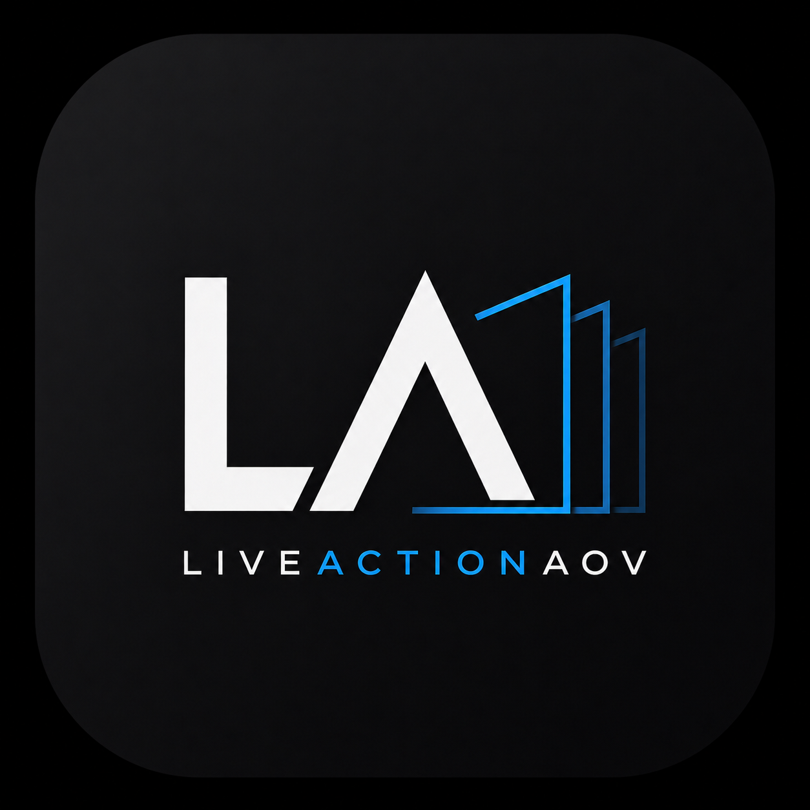
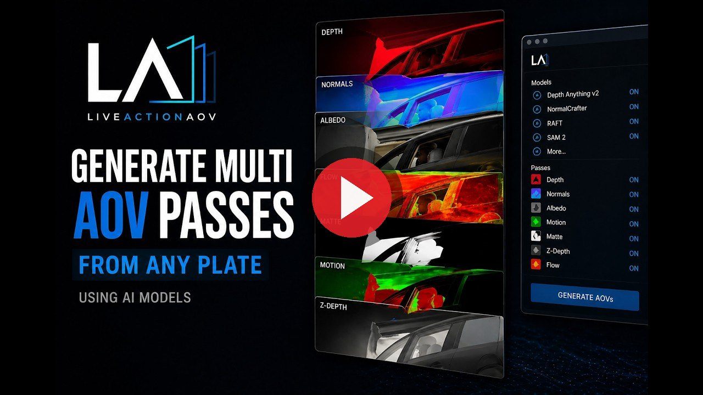
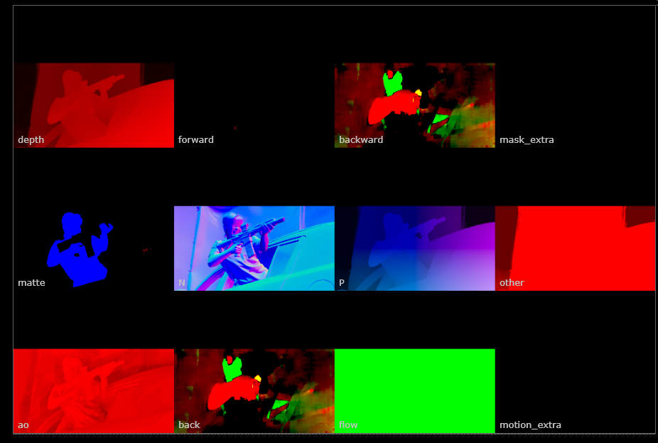
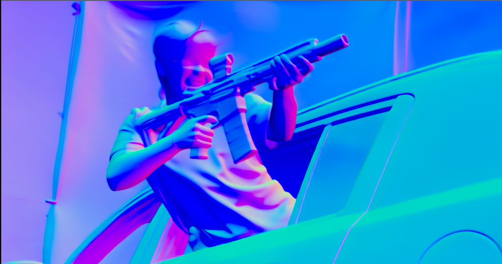
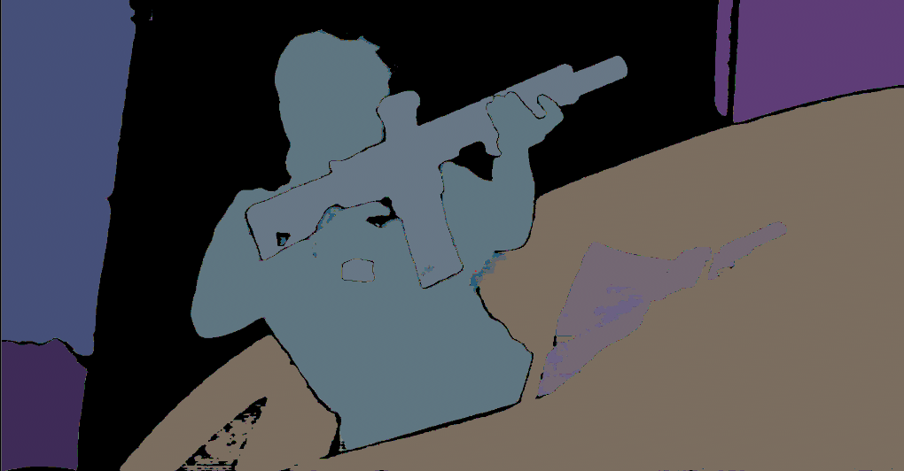
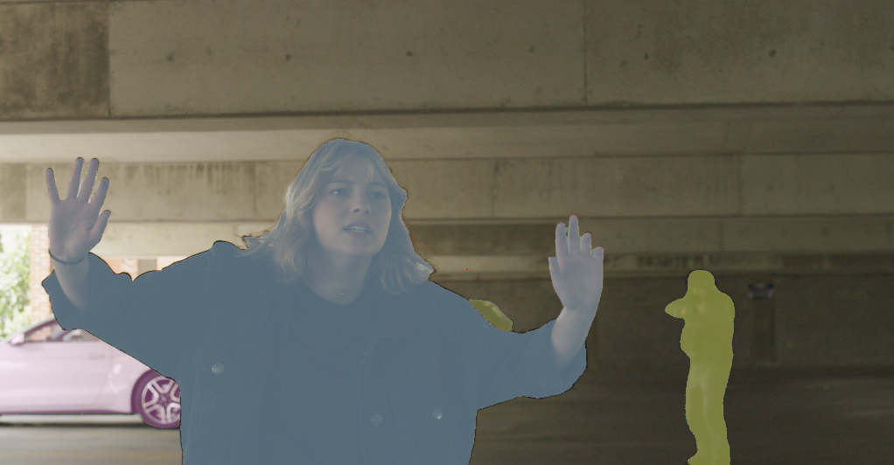
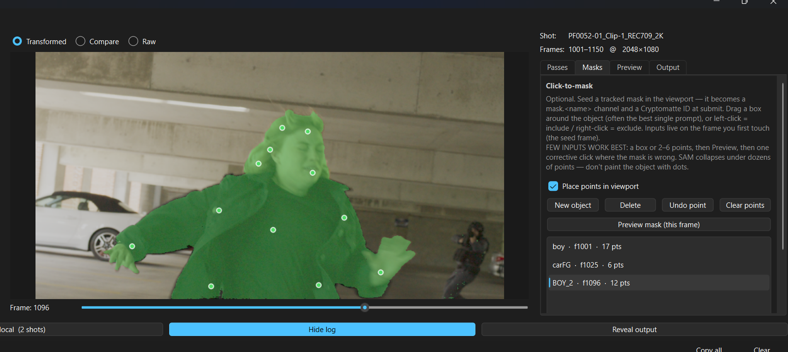
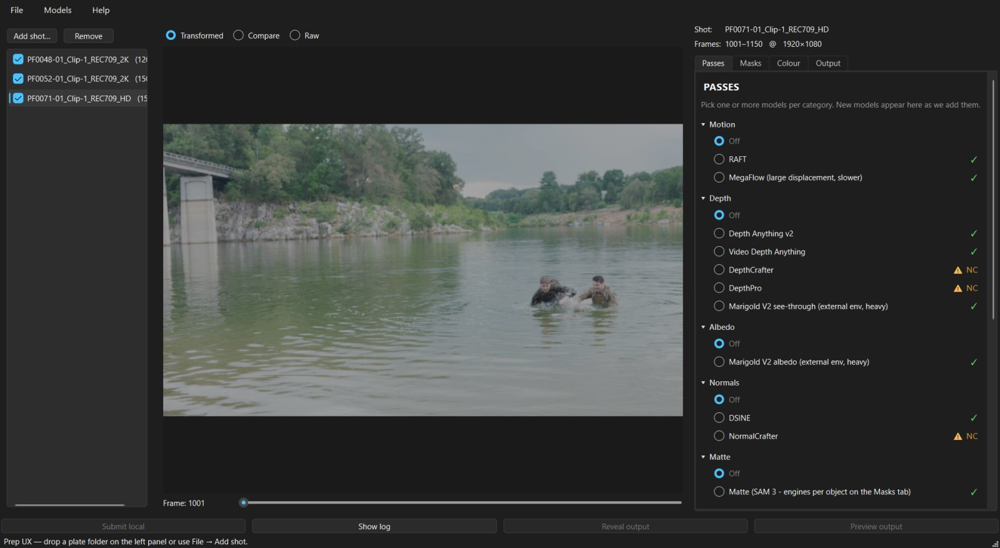
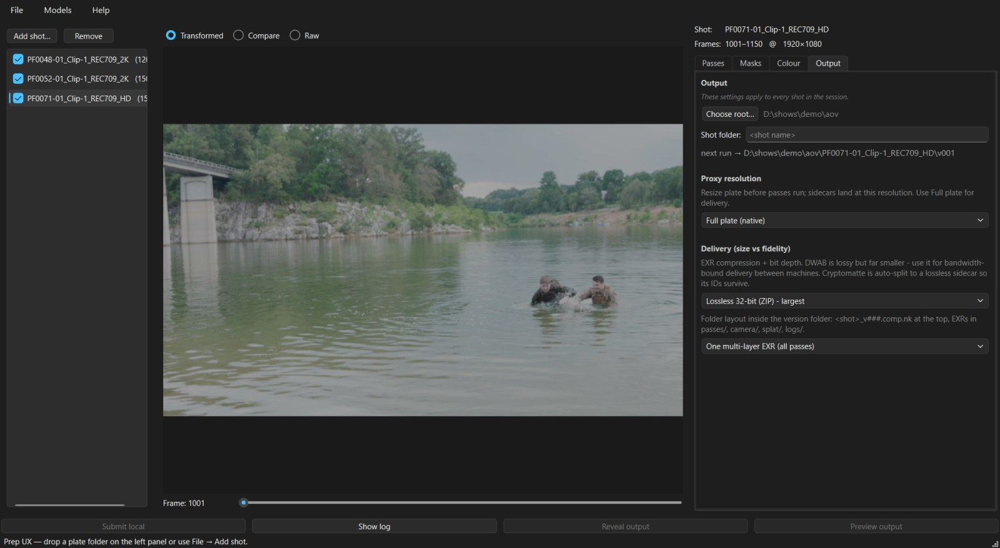

<p align="center">
  
</p>

# LiveActionAOV

**Live-action plates in, Nuke-ready AOVs out.** Point it at an EXR sequence and it gives you per-object mattes and Cryptomatte, depth, normals, motion vectors, a solved **camera track**, a **Gaussian-splat clean plate**, and a Nuke comp with all of it already wired. Everything runs locally on your GPU.

> **Status:** alpha, pre-v1. In development since April 2026, by Leonardo Paolini (VFX / 2D supervisor).

<p align="center">
  <a href="https://www.youtube.com/watch?v=HnosSnK1MKs">
    
  </a>
  <br>
  <a href="https://www.youtube.com/watch?v=HnosSnK1MKs"><b>▶ Watch the demo</b></a> — how it works, end to end
</p>

---

## Quick start

```powershell
# Windows (PowerShell or cmd.exe):
git clone https://github.com/lettidude/LiveActionAOV
cd LiveActionAOV
.\install.bat
```

```bash
# Linux / macOS:
git clone https://github.com/lettidude/LiveActionAOV
cd LiveActionAOV
./install.sh
```

> **PowerShell users:** the `.\` prefix is required — PowerShell doesn't run scripts from the current directory by default. `cmd.exe` accepts both `install.bat` and `.\install.bat`.

Then:
```bash
uv run liveaov-gui           # preparation GUI
uv run liveaov --help        # CLI reference
```

> **First run downloads model checkpoints from Hugging Face.** Expect
> **~1.5 GB** for a minimal stack (Depth Anything V2 + DSINE + RAFT +
> SAM 3 + ViTMatte) up to **~12 GB** for the full video-aware stack
> (DepthCrafter + NormalCrafter + MatAnyone 2). Cached at
> `~/.cache/huggingface/hub` (Linux/macOS) or
> `%USERPROFILE%\.cache\huggingface\hub` (Windows). Subsequent runs are
> offline-capable for any pass whose weights you've already pulled.

### Hugging Face authentication (one-time, required for SAM 3)

**SAM 3** is **gated** on Hugging Face — Meta's license terms, not ours — so the matte pass needs a one-time HF token. Three steps:

1. **Request access** at https://huggingface.co/facebook/sam3 — click **"Agree and access repository"** at the top of the page. Approval is usually instant.
2. **Create an HF token** at https://huggingface.co/settings/tokens — click **"Create new token"**, any name is fine, **"Read"** scope is sufficient (no write/admin needed). Copy the token string.
3. **Authenticate locally**, from the project root:

   ```bash
   uv run hf auth login
   ```

   (or `uv run huggingface-cli login` on older `huggingface_hub` versions). Paste the token when prompted. It's cached at `~/.cache/huggingface/token` and SAM 3 will download cleanly on the next run.

Prefer env vars? Set `HF_TOKEN=<your-token>` in your shell instead and skip step 3 — `transformers` and `huggingface_hub` pick it up automatically.

If you skip this, the matte pass fails on first use with `OSError: You are trying to access a gated repo. ... 401 Client Error`. Other models in the catalog (Depth Anything V2, DepthCrafter, NormalCrafter, DSINE, MatAnyone 2, RVM, RAFT) are **not** currently gated.

> **Updating to latest:** from the project root, run `.\update.bat` (Windows) or `./update.sh` (Linux/macOS). Pulls the latest code and re-syncs deps. Idempotent if there's nothing new.
>
> **What is `uv`?** A fast Python package manager from Astral —
> drop-in replacement for `pip` + `venv`. The installer scripts grab
> it for you. See [docs.astral.sh/uv](https://docs.astral.sh/uv/) if
> you'd rather install it yourself first.

---

## What it does

Given a plate like `/shots/sh020/plate/v003/sh020_plt.####.exr`, the tool produces:

- `<out>/sh020/v001/passes/sh020_v001.utility.####.exr` — sidecar with:
  - `Z` depth channel
  - `N.x / N.y / N.z` camera-space normals
  - `motion.x / motion.y` forward motion vectors (pixels)
  - `back.x / back.y` backward motion vectors
  - `matte.r / g / b / a` top-4 soft hero mattes
  - `mask.<concept>` semantic hard masks
  - `P.x / P.y / P.z` world-space position (when depth is present)
  - `ao.a` ambient occlusion (when depth + normals are present)

Plus `sh020_v001.comp.nk` (everything wired in Nuke), `camera/`, `splat/` and `logs/` in the same version folder; every run gets a new `v###`. Nothing is written next to the plate and the original plate is never modified. See [design notes](docs/architecture.md) for architectural details.

---

## The passes, visualized

Every pass lands as a channel in one sidecar EXR. Here's a full utility set baked from a single live-action plate — depth, camera-space normals, forward/backward motion, the matte + Cryptomatte object IDs, world position, ambient occlusion:

<p align="center">
  
</p>

Close-ups — **normals** (camera-space surface orientation, drives relight) and a **Cryptomatte** breakdown (every object gets its own ID, pickable in Nuke just like a CG render):

<p align="center">
  
  
</p>

…and a per-object matte composited back over the plate — the kind of fast, named selection the tool makes from a few clicks:

<p align="center">
  
</p>

> Test plate from the [ActionVFX practice footage library](https://www.actionvfx.com/collections/free-vfx/category).

---

## Camera track and clean plate

Tick **Camera track** and the shot gets a matchmove: COLMAP structure-from-motion with the SAM 3 masks keeping moving people out of the solve. You get a Nuke `Camera2`, a point cloud and the COLMAP model in `camera/`. Checked inside Nuke 16 by reprojecting the solved points: **0.73 px** on an ActionVFX plate, 0.8 px on an ALEXA 65 plate, 1.3 px on a Netflix test plate.

Add **Gaussian splat** and the camera plus the plate train a 3D Gaussian splat of the set, with the masked objects left out. Rendered back through the camera it gives a **clean plate** with the people removed, plus a depth pass, wired into the comp.

A camera needs parallax. On a locked-off shot or a pure pan the solve fails cleanly: camera and splat are skipped, every other pass is still written, and the log says why.

---

## Check the output without Nuke

Every run goes to `<your root>/<shot>/v001/`, then `v002`, and so on. Nothing is ever overwritten and nothing is written next to the plate:

```
<root>/<shot>/v001/
    <shot>_v001.comp.nk      open this in Nuke
    passes/                  the utility EXRs (+ Cryptomatte)
    camera/                  Nuke camera, point cloud, COLMAP model
    splat/                   clean plate + splat
    logs/
```

Right-click a shot and choose **Preview output** to scrub any version, layer by layer, with each mask over the plate and the camera and splat numbers underneath.

---

## Interactive roto — click to a soft-edged Cryptomatte

Click an element in the viewport (or drag a box around it); the SAM 3 tracker propagates it across the whole shot into a named **Cryptomatte ID**. The refiner (ViTMatte by default, BiRefNet under Advanced) turns the hard mask into a roto-grade **soft alpha** — hair, motion blur, fine edges — written to the `matte.*` channels. Preview the mask on the seed frame before committing, refine a click at a time. All local, commercial-clean, scene-referred.

<p align="center">
  
</p>

The Masks tab: seed objects with a box or a few clicks, preview the SAM 3 mask on the spot, and build a named per-object list — each becomes a Cryptomatte ID at submit. The refiner gives those masks soft, roto-grade edges:

<p align="center">
  
</p>

> Soft alpha from the BiRefNet refiner composited over the plate — note the hair and motion-blur edge detail that SAM 3's hard masks can't give on their own. Tip: fewer clicks work better — a box or 2–6 points beats dozens.

---

## The GUI

Drop a plate folder onto the shot list, pick the passes you want, hit **Submit local**. Each model surfaces its license badge inline so you know up-front which combinations are commercial-safe and which require non-commercial confirmation.

<p align="center">
  
</p>

One engine menu: **Auto** (ViTMatte) is the default, green/blue screen keying is one click away, everything else sits under Advanced. Any object in the Masks tab can use its own engine, and its preview updates as soon as you change it.

A batch of shots with the Output tab open: one output root for the session, the next version folder shown before you submit, proxy resolution and delivery format. The centre viewport shows the "what the model sees" Transformed view.

<p align="center">
  
</p>

> Test plate above is from the [ActionVFX practice footage library](https://www.actionvfx.com/collections/free-vfx/category) — used here under their license, which permits incorporation into derivative work like this tool demo.

---

## Nuke plugin — UtilityRelight

A companion Nuke node ships in this repo at
[`src/live_action_aov/plugins/nuke/UtilityRelight/`](src/live_action_aov/plugins/nuke/UtilityRelight/).
It consumes a sidecar EXR + a beauty plate and gives Nuke comp artists
live 3D light placement on the subject — six layered light contributions
(key, spec, rim, bounce, glow, fog) computed on the GPU via BlinkScript.

**Install (3 steps):** copy `utility_relight.py` + `UtilityRelightKernel.blink` into `~/.nuke/`, register in `~/.nuke/menu.py`, restart Nuke. Full instructions and quick-test recipe in the [user guide](docs/user-guide.md#nuke-plugin--utilityrelight).

Tested on Nuke 16.0.

---

## Documentation

- [User guide](docs/user-guide.md)
- [Developing plugins](docs/developing-plugins.md)
- [Architecture](docs/architecture.md)
- [Install reference](docs/install.md) — alternate GPU configurations (Pascal/Volta, Apple Silicon, ROCm), troubleshooting, slim install with per-pass extras

---

## Compatibility

| Platform | GPU | Status |
|---|---|---|
| Windows 11 | NVIDIA RTX 20 / 30 / 40 / 50 series | ✅ **Main platform** (developed and tested on an RTX 5090; proxy mode for smaller cards) |
| Linux (Ubuntu 22.04+) | NVIDIA RTX 20 / 30 / 40 / 50 series | ⚠️ Expected to work via `install.sh` (CUDA + uv path identical to Windows) but **not regularly tested**. Bug reports welcome. |
| macOS (Apple Silicon) | M1 / M2 / M3 / M4 (MPS) | ⚠️ **Best-effort.** Some passes work via MPS; fp16 models (DepthCrafter, NormalCrafter, MatAnyone2) are CUDA-only. The GUI refuses Submit and explains when a pass isn't available. |
| Any platform | AMD GPU (ROCm) | ❌ Untested — wheels exist, none of our passes have been validated against them. |
| Any platform | CPU-only | ❌ Not a supported configuration — fp16 kernels don't exist on CPU. |

See [docs/install.md](docs/install.md#alternate-gpu-configurations) for manual overrides on older NVIDIA hardware (Pascal / Volta cu121 wheel) and Apple Silicon notes.

---

## Author

**Leonardo Paolini** — VFX supervisor and 2D compositing supervisor, building ML tools for comp.

- Email: [LeonardoVFX@gmail.com](mailto:LeonardoVFX@gmail.com)
- GitHub: [@lettidude](https://github.com/lettidude)
- LinkedIn: [leonardopaolinivfx](https://www.linkedin.com/in/leonardopaolinivfx/)
- IMDb: [Leonardo Paolini](https://www.imdb.com/name/nm5886055/)
- YouTube: [@LeonardoVFX](https://www.youtube.com/channel/UCZDR5tThQwo9OVVu-NmODbA) — pipeline & VFX-tooling videos

Developed with [Claude](https://claude.com/) (Anthropic).

---

## Support

- **Bug reports / feature requests:** [open an issue](https://github.com/lettidude/LiveActionAOV/issues).
- **Direct contact:** [LeonardoVFX@gmail.com](mailto:LeonardoVFX@gmail.com) — studio pipelines, commercial licenses, integration.

---

## License

LiveActionAOV is developed by Leonardo Paolini, public since April 2026. From 30 October 2026 (the main branch and v0.10.0 onward) it is released under the [Business Source License 1.1](LICENSE):

- **Free** for individuals and freelancers, studios under 10 people, and any non-commercial use (education, research, personal projects).
- **Studios of 10 or more people** need a one-off commercial license per major version: see [COMMERCIAL.md](COMMERCIAL.md).
- Each version becomes **Apache-2.0** four years after its release.
- Code published before 30 October 2026 stays under the MIT License.

The AI models LiveActionAOV downloads and the vendored code under `src/live_action_aov/vendored/` keep their own licenses — see the license matrix in [architecture notes](docs/architecture.md#license-matrix). Every sidecar EXR carries a `liveActionAOV/<pass>/license` metadata stamp plus a top-level `liveActionAOV/matte/commercial` flag so downstream QC can audit what's shippable.
