<p align="center">
  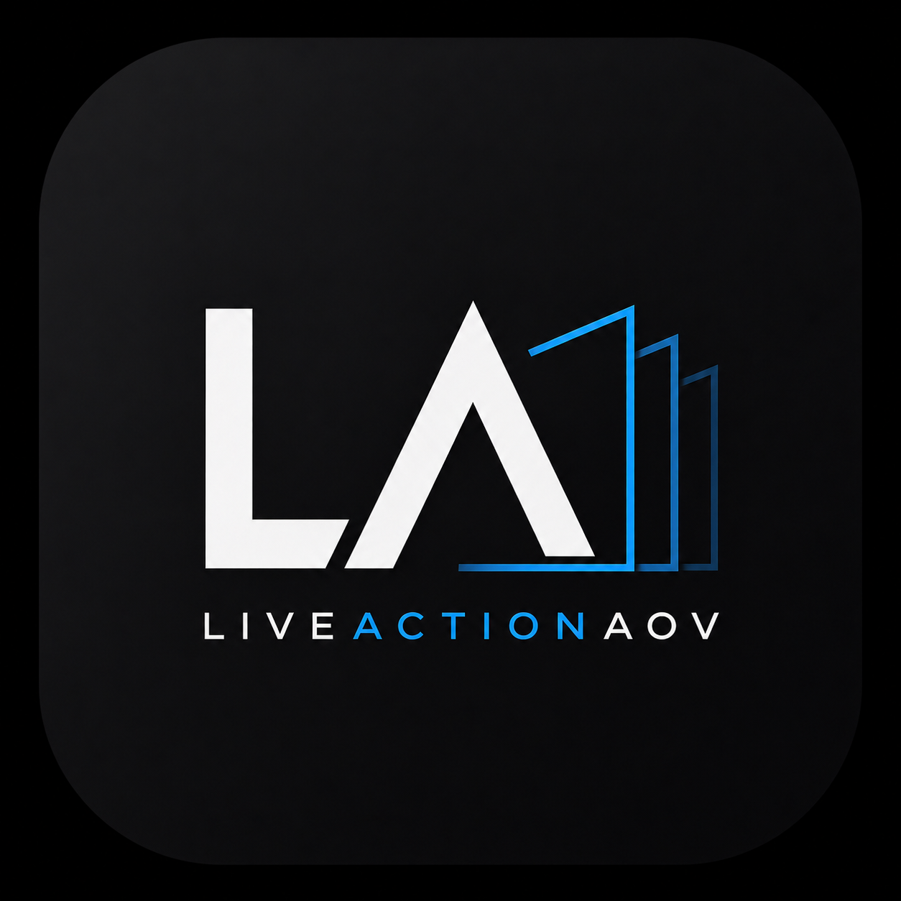
</p>

# LiveActionAOV

**Live-action plates in, Nuke-ready AOVs out.** Point it at an EXR sequence and you get per-object mattes and a Cryptomatte, depth in metres, normals, motion vectors, a solved camera, a 3D splat of the set, and a Nuke script with all of it wired up. It runs on your own machine; the only thing that ever goes over the network is the optional LTX Alpha step, and only if you point it at a ComfyUI on another box.

Built by [Leonardo Paolini](#author), a VFX and 2D compositing supervisor, for the prep work that eats the first days of every shot. In development since April 2026 and in daily use on real shots; some parts are still moving, see [Status](#status).

<p align="center">
  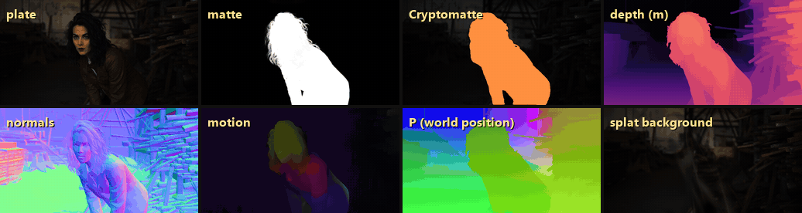
</p>

<p align="center"><sub>One run on a 2K plate, the person found by name: nothing clicked, nothing painted.</sub>
</p>

## What you get

From one plate folder, one run writes a version folder next to it:

| Output | What it is | How |
|---|---|---|
| **Mattes** | Soft, roto-grade alpha per object, with hair and motion blur | SAM 3.1 (or SAM 3) finds and tracks the objects; **LTX-2.5 Alpha** on the whole frame gives the soft edge when your ComfyUI has it, ViTMatte when it does not |
| **Cryptomatte** | Every object as a pickable ID, like a CG render | from the same tracks |
| **Depth** | `Z` in metres, plus `P` world position | MoGe-3 (default), Depth Anything V2, Video Depth Anything |
| **Normals** | Camera-space `N`, steady over the shot | MoGe-3 |
| **Motion** | Forward and backward vectors in pixels, Nuke VectorBlur names included | RAFT or MegaFlow |
| **Camera** | A Nuke `Camera2` with its error and coverage in the label, the same camera as **USD** for Houdini, Maya, Blender and Unreal, a coloured point cloud of the set, COLMAP model | COLMAP, with the masked people kept out of the solve; nodal and depth-anchored fallbacks when parallax is short |
| **Splat background** | The set behind the people, re-rendered through the solved camera: a soft fill to start a patch from, not a finished clean plate | 3D Gaussian splat trained on the plate |
| **Clean plate** | The plate with the people painted out, frame by frame | *coming soon*, on LTX |
| **Nuke script** | `<shot>_v001.comp.nk`: Reads, the camera, the point cloud, a ScanlineRender, every layer shuffled out | written at the end of each run |

Everything lands in one multi-layer EXR per frame (or one sequence per pass, your choice), with the model licences stamped in the header so QC can check what is shippable.

## Requirements

- **Windows 11** (main platform) or Linux. macOS is best-effort, see [compatibility](#compatibility).
- **NVIDIA GPU**, RTX 20-series or newer. **16 GB** of VRAM runs everything at proxy resolution; **24 GB** runs 4K; **8 GB** is not enough for the matte and flow models. Driver 570 or newer for the 50-series.
- **RAM**: 32 GB for short shots at 2K, 64 GB or more for 4K. A clip that does not fit is run in overlapping windows of frames by itself, so a long shot is slower, not a crash.
- **Disk**: about 15 GB for the install, about 10 GB of model weights for the default set, up to 40 GB with every optional model.
- **Nuke** 11 or newer to open the result (tested on Nuke 16).
- **Gaussian splat** (the splat background) needs the `gsplat` wheel, which PyPI does not have for this torch/CUDA: download it from the [release](https://github.com/lettidude/LiveActionAOV/releases/latest) into `wheels\` and run `update.bat`, or build it with `scriptsuild_gsplat_wheel.bat`. Every other pass works without it.

## Quick start

```powershell
# Windows (PowerShell or cmd.exe)
git clone https://github.com/lettidude/LiveActionAOV
cd LiveActionAOV
.\install.bat
```

```bash
# Linux / macOS
git clone https://github.com/lettidude/LiveActionAOV
cd LiveActionAOV
./install.sh
```

The installer brings its own Python and `uv` (a fast package manager), checks your NVIDIA driver, and installs the CUDA build of torch. Then:

```bash
uv run liveaov-gui      # the app
uv run liveaov --help   # the command line
uv run liveaov doctor   # what this machine can run, and the settings to use
```

**One thing to do before the first run:** SAM 3 is a gated model on Hugging Face (Meta's terms, not ours). Accept the terms at [huggingface.co/facebook/sam3](https://huggingface.co/facebook/sam3), create a read token at [huggingface.co/settings/tokens](https://huggingface.co/settings/tokens), then run `uv run hf auth login` and paste it. Every other model downloads on its own the first time a pass needs it, then runs offline.

**Worth five more minutes on a 24 GB card or bigger:** `uv run liveaov setup-sam31` builds the environment for **SAM 3.1** (also gated: [huggingface.co/facebook/sam3.1](https://huggingface.co/facebook/sam3.1)). It tracks every person of a shot together, so two similar people keep their identity where SAM 3 can swap them. Once it is there the matte pass uses it by itself, and falls back to SAM 3 on a smaller card.

`liveaov doctor` reads the card and the RAM and proposes the settings: the proxy size, the detector, and whether a long clip will run in windows. The app shows the same line in the Output tab with a **Use suggested** button.

Updating later: `.\update.bat` or `./update.sh`. Studio machines with no internet: build one portable folder on a machine that is online and copy it, see [docs/install.md](docs/install.md#portable-build-for-studios-without-internet-tpn).

## First shot, in the app

1. Drop a plate folder on the shot list. The viewport shows what the models will see.
2. Press **Use the recommended set**, or tick the passes yourself. The defaults are the commercial-safe ones; anything non-commercial is marked **NC** and asks before it runs.
3. In the **Masks** tab, say what to find by name (People, People + vehicles, Everything) and add your own objects: a box or 2-6 clicks, preview the mask before you commit. Each object can have its own soft-edge engine and its own `matte.rgba` slot.
4. **Run**. Watch the log, or go for a coffee. The Output tab is one setting for every shot of the session; a single shot's frame range and crop live in **This shot**.
5. Right-click the shot, **Preview output**, and scrub every layer over the plate. Or open the `.comp.nk` in Nuke.

<p align="center">
  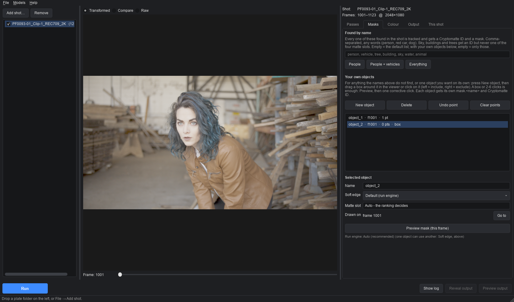
</p>

## Where it lands

```
plates/sh020_v003/                   your plate, untouched
plates/sh020_v003_utility/v001/      one folder per run, never overwritten
    sh020_v001.comp.nk               open this in Nuke
    passes/                          the utility EXRs (+ a lossless Cryptomatte sidecar)
    camera/                          Camera2 .nk, .usda, .json, point cloud, COLMAP model
    splat/                           the Gaussian splat (.ply)
    logs/                            run log + sh020_v001.run_report.json
```

The run report says, per pass, what ran, what fell back and why, timings, VRAM / RAM, verdicts and what needs a human
to look at it ([docs/run-report.md](docs/run-report.md)).

Or pick one root for the whole session in the Output tab (`--out` on the command line). Proxy resolution and delivery format (lossless 32-bit, or DWAB half-float at a fraction of the size) live in the same tab.

## The passes, closer

### Mattes: click to a soft-edged Cryptomatte

Tick **Matte** and every person, vehicle and animal in the shot is found and tracked into a named Cryptomatte ID (sky, buildings and trees get an ID too, but never take one of the four `matte.rgba` slots from a subject). For anything else, click it in the viewport or drag a box around it. The soft alpha with hair, motion blur and fine edges is written to `matte.*`. Green and blue screen keying is one click away in the same menu.

<p align="center">
  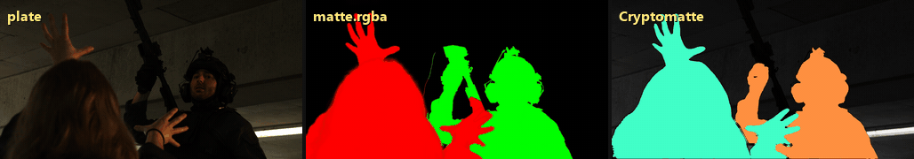
</p>

> Two people, found by name: one `matte.rgba` slot and one Cryptomatte ID each. The hand in front of the soldier stays with the woman it belongs to.

**LTX Alpha** is the default engine for the soft edge. **LTX-2.5 with the alpha-gen IC-LoRA** runs once on the **whole frame** and decides by itself what the foreground is; each tracked object then takes the foreground nearest to it. One run whatever the number of objects, and no mask cuts the outline, so it keeps what trimap matting loses: semi-transparent motion blur, strands of hair, a shoulder the tracker missed. Props and people nobody tracked land in a `foreground.a` layer. For the one object that needs more pixels (small, far away, fine hair on the hero), pick **LTX Alpha crop** on it in the Masks tab: it gets its own run on a rectangle around it.

<p align="center">
  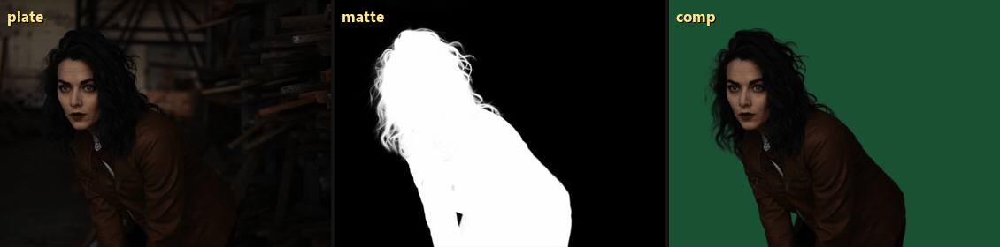
</p>

LTX runs in **your own ComfyUI** (the weights are not bundled; a one-click setup is in the works). Set its address in **Models > ComfyUI for LTX Alpha** and press **Test**. It checks the server, the nodes and the model files, and finds GGUF builds for smaller cards. Without ComfyUI the mattes come from ViTMatte (SAM finds the object, BiRefNet says where it is sure, ViTMatte resolves hair and blur), the log says so, and the run carries on. About a minute and a half per 100 frames at 2K on an RTX 5090.

<p align="center">
  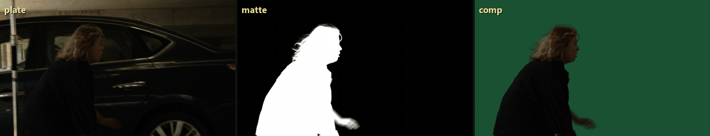
</p>

<p align="center">
  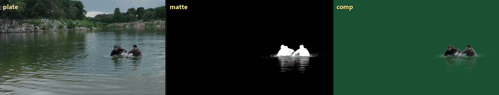
</p>

> Three runs with the defaults, nothing painted, nothing clicked: plate, the `foreground.a` matte, and the comp over a flat colour. Hair, motion blur, water. About a minute and a half of LTX per 100 frames on an RTX 5090.

### Geometry: depth in metres, normals, position

**MoGe-3** (Microsoft, MIT) is the default for normals and the best choice for depth. One pass gives depth in metres, camera-space normals and a `P` world-position pass you can drop into PositionToPoints or a relight. No halo around people, real structure in hair and faces, and normals 3-8x steadier frame to frame than DSINE's.

The tool fixes what a per-frame model gets wrong over a shot: one FOV per shot (from the camera track when there is one), a stabilised metric scale, letterbox bars cropped before the model sees them, sky flagged in `depth.confidence`. About 1 s per frame at 2K, 2.6 GB of VRAM at any resolution.

<p align="center">
  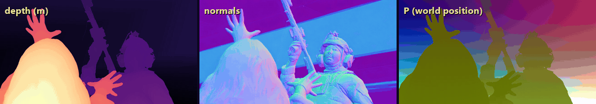
</p>

### Camera track

Tick **Camera track** and the shot gets a matchmove: COLMAP structure-from-motion, with the SAM 3 masks keeping the moving people out of the solve. You get a Nuke `Camera2`, the same camera as a `.usda` for other 3D software, a point cloud and the COLMAP model. With a depth pass in the same run the point cloud is dense and coloured from the plate, so the set is recognisable in the 3D viewer; without one it is the solve's feature points. Checked in Nuke 16 by reprojecting the solved points: 0.7-1.3 px on 2K to 6.5K test plates.

A camera needs parallax. When COLMAP registers only part of a shot, two fallbacks take over: a rotation-only solve for pans and locked-off shots, and a depth-anchored solve (MoGe-3 depth plus tracked corners) for fast handheld action. The depth-anchored camera is judged on held-out points it never saw during the solve and labelled **GOOD**, **WEAK** or **FAILED** in the Nuke node, with the error in pixels at a stated resolution; a FAILED one says "do not use" so it cannot end up in a comp by accident. The COLMAP camera gets the same verdict from an independent check, so a solve that drifted is caught even when its own error looks clean. Rotation-only cameras are judged the same way. Whatever happens to the camera, the other passes are still written.

### Splat background

Add **Gaussian splat** and the camera plus the plate train a 3D Gaussian splat of the set, with the masked objects left out. Rendered back through the solved camera it shows what was behind the people, plus a depth pass, wired into the comp. It is a soft rebuild, not a finished clean plate: good to start a patch from, or to see what the camera saw behind someone. It needs a GOOD or WEAK camera and some parallax; read [docs/gaussian_splat.md](docs/gaussian_splat.md) before trusting one on a shot.

<p align="center">
  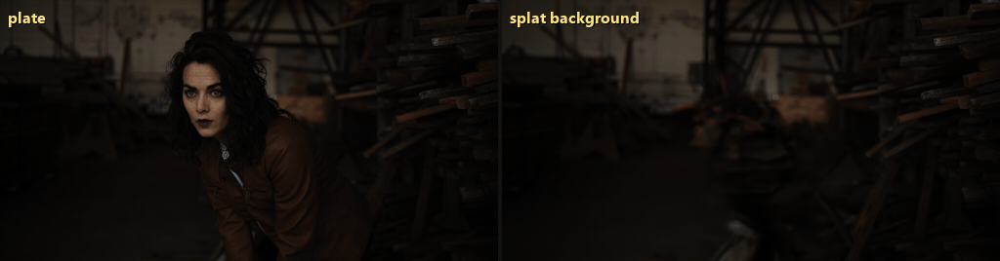
</p>

> Left: the plate. Right: the splat background from the same run, nothing painted and nothing clicked: the woman was found by name and left out of the training. Soft, as said above, and already tracked to the shot camera.

### Clean plate: coming soon

A real clean plate pass, built on LTX like the mattes, is on its way. Until then the splat background above is the starting point for a patch.

## The app

<p align="center">
  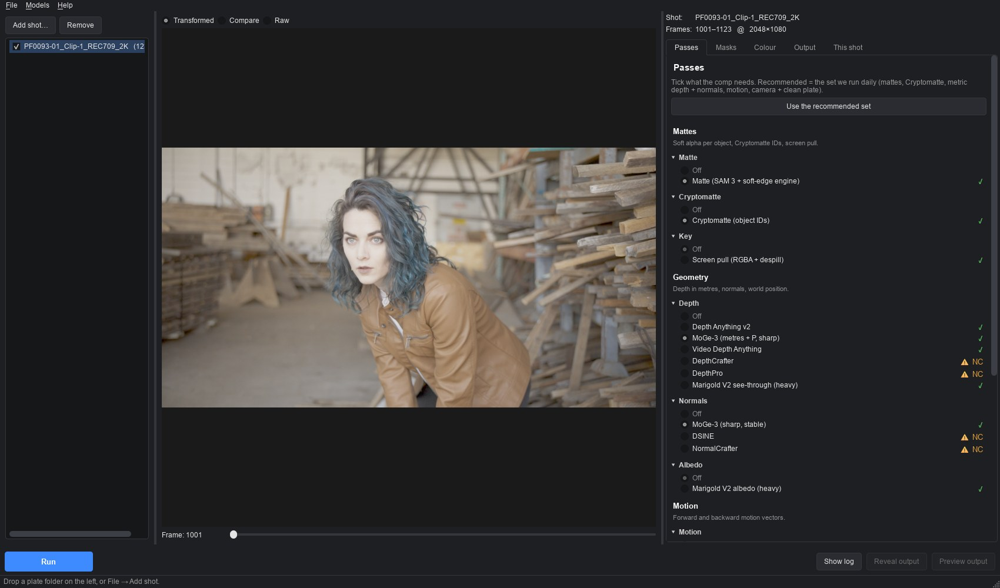
</p>

<p align="center">
  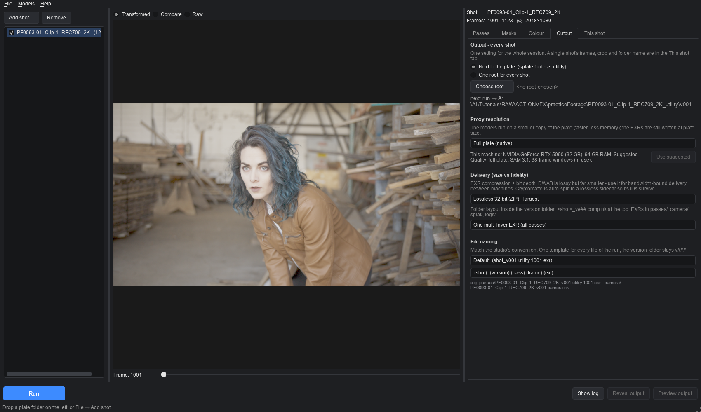
</p>

Three panels: shots on the left, the plate in the middle (what the models see, a compare view, or the raw plate), passes, masks, colour and output on the right. Every model shows its licence inline. The Output tab reads the card and the RAM and proposes the proxy size and the detector. Batches run unattended, a failed shot does not stop the queue, a long shot is cut in windows instead of running out of memory, and a model that crashes loses that pass only.

Prefer scripts? `liveaov run-shot <plate> -p matte,depth,normals,flow_megaflow,camera_pycolmap` does the same from a terminal or a farm.

## Nuke plugin: UtilityRelight

A companion Nuke node in [`src/live_action_aov/plugins/nuke/UtilityRelight/`](src/live_action_aov/plugins/nuke/UtilityRelight/). It reads a sidecar EXR plus the plate and gives a comp artist live 3D light placement on the subject, six layered contributions (key, spec, rim, bounce, glow, fog) on the GPU via BlinkScript. Install: copy two files into `~/.nuke/`, register in `menu.py`, restart. Details in the [user guide](docs/user-guide.md#nuke-plugin--utilityrelight).

## Status

Version 0.12, used daily on real production shots at 2K to 6K. What is solid: mattes, Cryptomatte, depth, normals, motion, the Nuke script, the camera on shots with parallax. What is still moving: the camera on fast handheld action, the splat background on shots with little parallax, the windows for long clips (new: whole-clip passes such as the tracker and the camera still need the RAM for the full clip), and the LTX setup. The [CHANGELOG](CHANGELOG.md) says what changed in each release; [issues](https://github.com/lettidude/LiveActionAOV/issues) are the place for bugs.

An early demo video (June 2026, the interface has changed since) is on [YouTube](https://www.youtube.com/watch?v=HnosSnK1MKs).

## Documentation

- [User guide](docs/user-guide.md): the command line, the app, the output folders, opening a run in Nuke
- [Install reference](docs/install.md): other GPUs, Apple Silicon, troubleshooting, the portable build for studios
- [Cryptomatte](docs/cryptomatte.md) and [Gaussian splat](docs/gaussian_splat.md): how they work and their limits
- [Architecture](docs/architecture.md) and [developing plugins](docs/developing-plugins.md): for people adding a pass

## Compatibility

| Platform | GPU | Status |
|---|---|---|
| Windows 11 | NVIDIA RTX 20 / 30 / 40 / 50 series | **Main platform.** Developed on an RTX 5090, used in production on 3090s and a 4060 (proxy mode). |
| Linux (Ubuntu 22.04+) | NVIDIA RTX 20 / 30 / 40 / 50 series | Expected to work via `install.sh` (same CUDA and `uv` path), not regularly tested. Bug reports welcome. |
| macOS (Apple Silicon) | M1 to M4 (MPS) | Best-effort. Some passes run on MPS, the fp16-only models do not. The app says which before you submit. |
| Any | AMD (ROCm) | Untested. |
| Any | CPU only | Not supported. |

Older NVIDIA cards (Pascal, Volta) and manual overrides: [docs/install.md](docs/install.md#alternate-gpu-configurations).

## Models, licences and thanks

LiveActionAOV is glue and comp sense on top of research that other people published openly. None of these models is ours, none ships inside the installer: each one is downloaded from its makers the first time a pass needs it, under its own licence. If the tool is useful to you, star and cite their work.

| Model | Used here for | Made by | Licence | Paid work |
|---|---|---|---|---|
| [SAM 3 / SAM 3.1](https://github.com/facebookresearch/sam3) | finding and tracking the objects | Meta AI (FAIR) | SAM License | yes (no military use; gated download) |
| [LTX-2.5](https://github.com/Lightricks/LTX-2) + alpha-gen IC-LoRA | soft mattes, in your ComfyUI | Lightricks | LTX-2 Community License | yes under USD 10M of yearly revenue, a Lightricks licence above |
| [ViTMatte](https://github.com/hustvl/ViTMatte) | soft mattes without ComfyUI | HUST Vision Lab | MIT | yes |
| [BiRefNet](https://github.com/ZhengPeng7/BiRefNet) | guide for ViTMatte, portrait mattes | Peng Zheng and co-authors | MIT | yes |
| [MoGe-3](https://github.com/microsoft/MoGe) | depth in metres, normals, position | Microsoft Research | MIT | yes |
| [DINOv2](https://github.com/facebookresearch/dinov2) | backbone of MoGe-3 and MegaFlow | Meta AI | Apache-2.0 | yes |
| [RAFT](https://github.com/princeton-vl/RAFT) | motion vectors | Princeton Vision & Learning Lab | BSD-3-Clause | yes |
| [MegaFlow](https://github.com/cvg/megaflow) | motion on fast action | ETH Zurich, Computer Vision and Geometry Lab | Apache-2.0 | yes |
| [COLMAP](https://github.com/colmap/colmap) / pycolmap | camera track | Johannes Schönberger and contributors, ETH Zurich and UNC Chapel Hill | BSD-3-Clause | yes |
| [gsplat](https://github.com/nerfstudio-project/gsplat) | splat background | the nerfstudio project | Apache-2.0 | yes |
| [Depth Anything V2](https://github.com/DepthAnything/Depth-Anything-V2), [Video Depth Anything](https://github.com/DepthAnything/Video-Depth-Anything) | alternative depth | the Depth Anything team (HKU, ByteDance) | Apache-2.0 for the **Small** models, the only ones the tool loads | yes |
| [Cryptomatte](https://github.com/Psyop/Cryptomatte) | the ID matte format | Psyop | BSD-3-Clause | yes |
| [Robust Video Matting](https://github.com/PeterL1n/RobustVideoMatting) | alternative matte engine | Shanchuan Lin and co-authors, ByteDance | GPL-3.0 | the mattes yes; the model is fetched from its repository and must not be shipped inside a closed bundle |

Marked **NC** in the app and refused on the command line without `--allow-noncommercial`, because their licences do not allow paid work: [DSINE](https://github.com/baegwangbin/DSINE) (Imperial College London), [DepthCrafter](https://github.com/Tencent/DepthCrafter) and [NormalCrafter](https://github.com/Binyr/NormalCrafter) (both built on Stable Video Diffusion), [Depth Pro](https://github.com/apple/ml-depth-pro) (Apple), [MatAnyone](https://github.com/pq-yang/MatAnyone) (NTU S-Lab).

Under the hood: [OpenImageIO](https://github.com/AcademySoftwareFoundation/OpenImageIO), [OpenColorIO](https://github.com/AcademySoftwareFoundation/OpenColorIO) and OpenEXR from the Academy Software Foundation, PyTorch, Hugging Face `transformers`, Qt for Python, `uv`, and [ComfyUI](https://github.com/comfyanonymous/ComfyUI), which runs LTX as your own separate server.

Licences change. This table was checked against each repository on 10 November 2026; the terms in the model's own repository are the ones that count, and every sidecar EXR records which model and licence made each layer.

## License

LiveActionAOV is released under the [Business Source License 1.1](LICENSE):

- **Free** for individuals and freelancers working on their own, for studios with fewer than 10 people, and for any non-commercial use (education, research, personal projects).
- **Studios of 10 or more people** need a one-off commercial licence per major version: see [COMMERCIAL.md](COMMERCIAL.md) and ask for a quote.
- Each version becomes **Apache-2.0** four years after its release. Code published before 30 October 2026 stays MIT.
- Not covered: reselling it, or offering it as a hosted service.

The AI models it downloads keep their own licences, listed in [Models, licences and thanks](#models-licences-and-thanks): the defaults allow paid work, LTX-2.5 is free for organisations under USD 10M of revenue, and the models marked NC are not for client work. Every sidecar EXR carries a `liveActionAOV/<pass>/license` stamp and a `liveActionAOV/matte/commercial` flag so downstream QC can audit what is shippable.

## Author

**Leonardo Paolini**, VFX supervisor and 2D compositing supervisor. Framestore, MPC and others in London, now in Tenerife, building tools for comp.

- Email: [LeonardoVFX@gmail.com](mailto:LeonardoVFX@gmail.com) (studio pipelines, commercial licences, integration)
- GitHub: [@lettidude](https://github.com/lettidude) | LinkedIn: [leonardopaolinivfx](https://www.linkedin.com/in/leonardopaolinivfx/) | IMDb: [Leonardo Paolini](https://www.imdb.com/name/nm5886055/) | YouTube: [@LeonardoVFX](https://www.youtube.com/channel/UCZDR5tThQwo9OVVu-NmODbA)

Developed with [Claude](https://claude.com/) (Anthropic). Test plates from the [ActionVFX practice footage library](https://www.actionvfx.com/collections/free-vfx/category), used under their licence.
